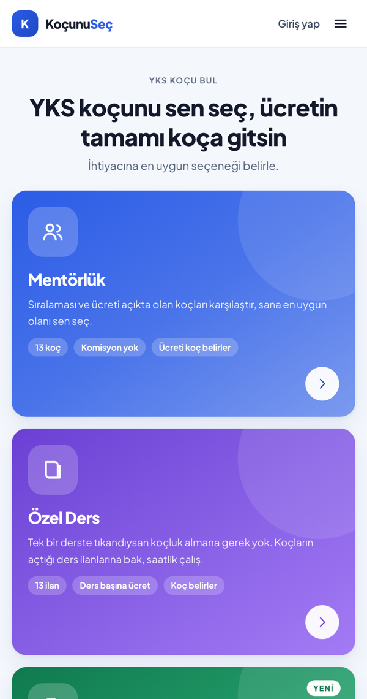
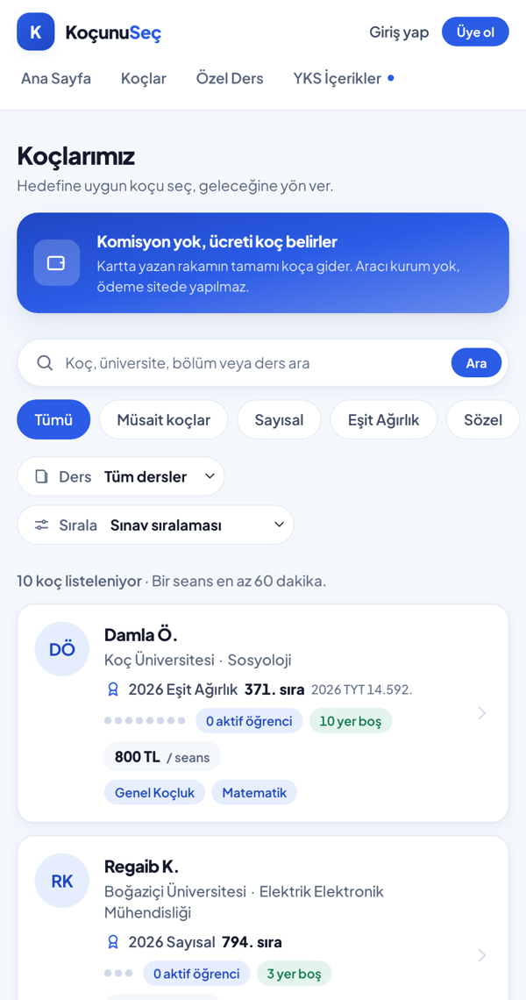
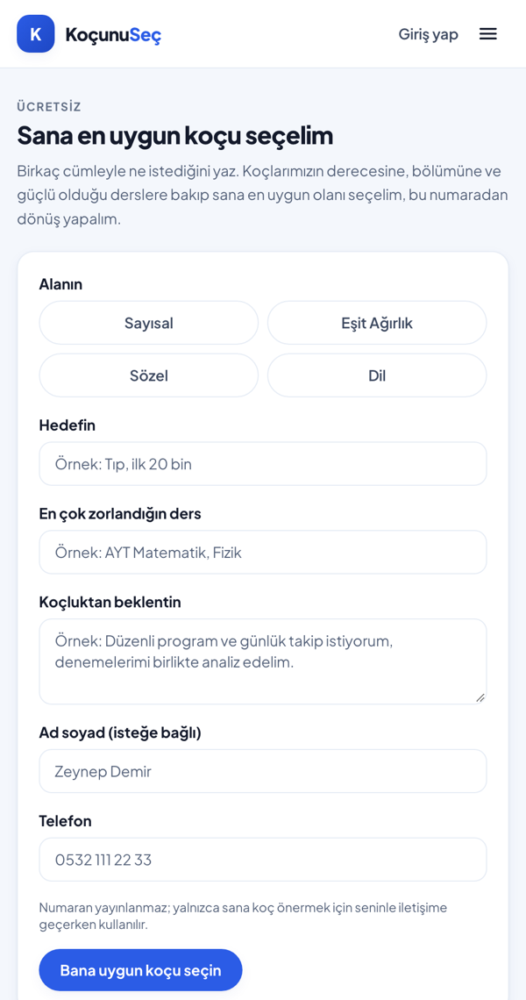
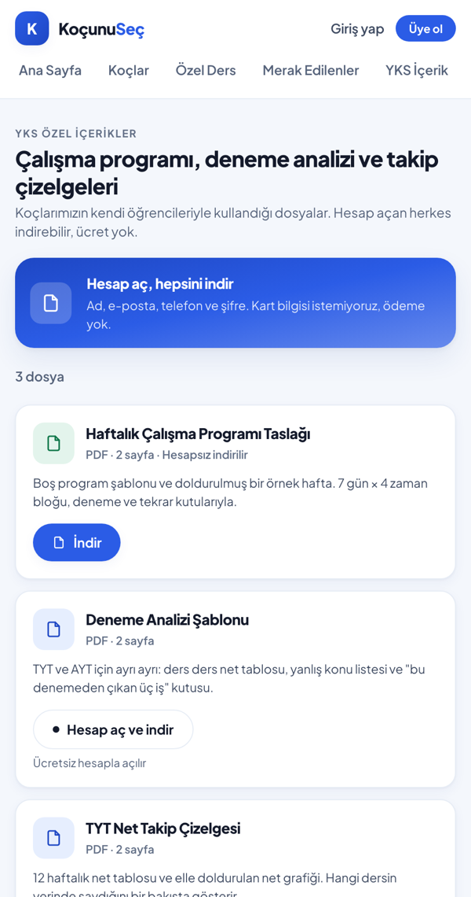

# Koçunu Seç

**Komisyonsuz YKS koçluk ve özel ders platformu**

[▶ Siteyi gör](https://kocunusec.com)

---

Koçunu Seç, YKS'ye hazırlanan öğrencileri derece yapmış üniversite öğrencileriyle buluşturan bir platform. Öğrenci koçların sıralamasını, üniversitesini ve ücretini açıkça görüp kendi koçunu seçiyor. Koçun belirlediği ücretten komisyon alınmıyor.

  
  &nbsp;
  

## Öne çıkanlar

- **Koçunu kendin seç**: sıralama, üniversite, bölüm, ücret ve boş kontenjan her koçun kartında açık
- **Komisyon yok**: ücreti koç belirler, aracı kesinti yapılmaz
- **Mentörlük ve özel ders bir arada**: haftalık koçluk da, tek derslik özel ders de aynı yerde
- **Sana en uygun koçu seçelim**: kısa bir form, öğrencinin alanına ve hedefine göre koç önerisi
- **Doğrulanmış koçlar**: sıralamalar ÖSYM sonuç belgesiyle kontrol ediliyor
- **Ücretsiz YKS içerikleri**: haftalık program, haftalık hedefler, deneme analizi ve net takip şablonları
- **Koç ve yönetim panelleri**: başvurular, öğrenci takibi ve eşleştirme talepleri

  
  &nbsp;
  

## Durum

Yayında: [kocunusec.com](https://kocunusec.com). Aktif geliştirme sürüyor. Kaynak kod gizli tutulmaktadır.
